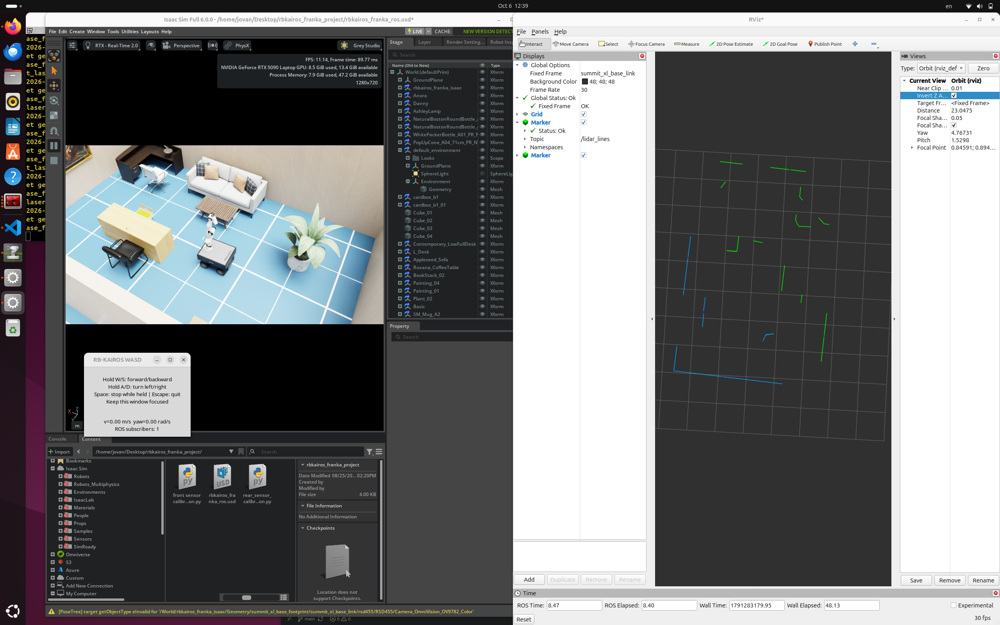

# [IN PROGRESS] Indoor robot perception with Isaac Sim and ROS 2
 
A ROS 2 Jazzy project for an RB-KAIROS mobile robot with a Franka arm and six
RealSense D455 cameras in Isaac Sim 6.0.0. It provides LiDAR outlines, keyboard
driving, paired RGB/depth recording, depth-initialized MCMC reconstruction,
SceneSplat feature processing and an external object-query service.

**Current status (2026-10-12):** the changed-room SceneSplat run and saved map
are identified in [WORKFLOW.md](WORKFLOW.md#current-status--2026-10-12). The map,
adapted laser scans and robot footprint display in RViz. Measured-pose
localization and Nav2 planning were checked live. Monitored driving reached about
0.2 m/s but timed out before goal success; the user reports that the manual
Nav2 startup and driving workflow works. Final heading and wheel slip remain
unresolved. The clickable semantic bridge previews candidates and sends goals
only after approval. Its isolated ROS tests passed, but a live semantic approach
has not reached a verified goal. Localization uses Isaac measured pose; AMCL is
not configured. Use the [restart checklist](WORKFLOW.md#restart-checklist--saved-map-and-scenesplat-navigation)
for exact commands and [AGENTS.md](AGENTS.md) for the continuation handoff.



## Current implementation

| Component | Functionality |
| --- | --- |
| Dual LiDAR processing | Range filtering, clustering, recursive split-and-merge and PCA line fitting |
| RViz visualization | Separate front/rear outlines, sensor range boundaries and rolling marker history |
| Keyboard teleoperation | Configurable linear/angular commands, combined key input and stop on focus loss |
| Isaac Sim integration | Mobile-base drive and front/rear LiDAR demonstrated during development; D455 RGB/depth publication observed |
| Camera capture | Six-camera RGB/depth pairs, intrinsics and image-time optical TF; actual captures inspected |
| MCMC reconstruction | Depth initialization, fixed measured poses, checkpoints and world-coordinate PLY export |
| Unified processing | Capture validation → MCMC → SceneSplat extraction → feature viewer; recording is a separate command |
| Object queries | External SigLIP2 scoring and DBSCAN; `/find_object` returns candidate bbox/centroid in world metres |
| Query visualization | RViz MarkerArray on `/object_query/markers`; user confirmed display works |
| Localization | Measured Isaac base TF publishes `/nav/odom` and navigation TF aliases; no AMCL |
| Navigation map and Nav2 | Saved changed-room map, corrected scan adapter, measured footprint and live route planning checked; goal completion remains unverified |
| Semantic navigation | Click an RViz candidate to preview an approach; explicitly approve before Nav2 receives a goal; live final approach remains unverified |

The D455 simulation setup has produced 1280 × 720 CameraInfo with fx = fy approximately 634.086 pixels and zero distortion. Camera capture requires correctly configured optical TF and image-time transforms, as described below.

## System architecture

```text
WASD -> /cmd_vel -> working Isaac differential drive
Isaac LiDAR -> outline node -> RViz
Isaac six-camera RGB/depth + intrinsics + measured optical TF
  -> capture_camera -> RGB PNG + depth NPY + JSONL
  -> unified processing -> depth-initialized MCMC -> world-coordinate PLY
  -> SceneSplat features + matching filtered PLY
     -> browser feature viewer (8083)
     -> external /find_object -> candidate bbox + centroid -> RViz

Isaac measured base TF + /clock -> isaac_localization -> /nav/odom
  + world -> nav_odom -> nav_base
Corrected LiDAR scans + saved world map -> Nav2 planner/controller
/find_object -> candidate boxes -> RViz click -> approach/path preview
  -> explicit approval -> Nav2 goal -> /cmd_vel -> Isaac drive

Live goal completion and final heading response remain to be verified.
```

## Mapping, localization, navigation and object prompts

The commands below belong to separate stages. Open the verified Isaac scene and
press **Play** before using live ROS nodes. Run each long-running process in its
own terminal, and check for an existing instance before starting another.

1. **Create a map:** run the corrected scan adapter and `world_map`, drive the
   room manually, then save `/nav/map` as a new map file. See
   [mapping and map saving](WORKFLOW.md#8-localization-and-nav2-setup-in-progress).
   The current changed-room saved map is
   `maps/room_redo_20261012T141102.yaml`; mapping again is optional when using
   that map.
2. **Localize the robot:** start `isaac_localization` to publish `/nav/odom`
   and navigation TF from Isaac's measured base pose. This is simulator pose,
   not AMCL. See the [restart checklist](WORKFLOW.md#restart-checklist--saved-map-and-scenesplat-navigation).
3. **Start Nav2:** use the saved map and measured footprint with
   `navigation.launch.py`. Its launch includes a map server, so use only one
   map server. Keep keyboard teleop stopped when Nav2 drives. The exact
   changed-room launch and RViz setup are in the [restart checklist](WORKFLOW.md#restart-checklist--saved-map-and-scenesplat-navigation).
4. **Prompt for an object:** start `/find_object` with the matching completed
   SceneSplat run, then call the service with a text query such as
   `ros2 service call /find_object lidar_outline_interfaces/srv/FindObject
   "{query: 'plant'}"`. Candidate boxes appear in RViz. See
   [object-query setup](WORKFLOW.md#5-external-object-queries).
5. **Preview an approach:** start `semantic_navigation`, select a numbered box
   with RViz's **Interact** tool, and inspect the route. Selection does not
   move the robot. Right-click the same box and explicitly approve only when
   ready to navigate. See [clickable semantic navigation](WORKFLOW.md#10-click-scenesplat-candidates-in-rviz-and-preview-navigation).

The saved map and SceneSplat run must describe the same room in matching world
coordinates. Object boxes are candidates, and a completed Nav2 or semantic goal
in the changed room has not yet been verified.

[The extraction node](lidar_outline/lidar_outline_node.py) converts finite in-range polar samples to XY, groups consecutive points by distance, recursively splits at excessive perpendicular error, fits lines with PCA/SVD and merges neighboring near-collinear segments. Defaults: 0.20 m cluster gap, 0.06 m split/merge-offset thresholds, four samples, 0.15 m minimum displayed length, eight degrees merge angle and five historical outlines per sensor. Parameters are read and validated at startup. Front lines are green, rear lines blue; range boundaries are red/orange.

Markers retain the scan frame and timestamp. The package does not transform scans into a global map; RViz uses external TF. Marker QoS is reliable/transient-local, depth 20; scan subscriptions use sensor-data QoS.

[Teleop](lidar_outline/wasd_teleop.py) publishes at a nominal 20 Hz using the GUI wall-clock timer, even when simulation is paused. Displayed velocity is a **command**, not measured motion. Camera capture uses measured TF, not command integration.

| Interface | Default topic | Message |
| --- | --- | --- |
| LiDAR inputs | `/front_laser/scan`, `/rear_laser/scan` | LaserScan |
| Outline outputs | `/lidar_lines`, `/lidar_max_range` | Marker |
| Drive command | `/cmd_vel` (relative `cmd_vel` in teleop) | Twist |
| Camera inputs | `/d455/rgb/image_raw`, `/d455/camera_info` | Image, CameraInfo |
| Optional depth | `/d455/depth/image_raw` (and matching numbered namespaces) | Image |
| Recorder pose/time | `/tf`, `/tf_static`, `/clock` | TFMessage, Clock |

## Repository structure

| Path | Purpose |
| --- | --- |
| [lidar_outline/](lidar_outline/) | Installed ROS nodes and helpers for LiDAR, capture, queries and localization |
| [scripts/](scripts/) | Standalone MCMC/SceneSplat pipeline, query worker and launch/build helpers |
| [interfaces/](interfaces/) | Separate nested ROS package defining `FindObject.srv` and candidate messages |
| [archive/](archive/README.md) | Preserved retired Splatfacto and TF workflows |
| [WORKFLOW.md](WORKFLOW.md) | Current restart, navigation and semantic-query commands |
| [launch/lidar_outline.launch.py](launch/lidar_outline.launch.py) | Extraction and RViz with `use_sim_time=True` |
| [test/](test/) | Active extraction, capture, pose, MCMC, query, pipeline and localization checks |
| [resource/lidar_outline](resource/lidar_outline) | ament package-index marker |
| [package.xml](package.xml), [setup.py](setup.py), [setup.cfg](setup.cfg) | Dependencies, installed entry points and executable locations |
| [AGENTS.md](AGENTS.md) | Simulation development notes |
| [.gitignore](.gitignore) | Generated builds, caches and capture/training outputs |

## Requirements

Development environment: Ubuntu, ROS 2 Jazzy and Isaac Sim 6.0.0. Locally inspected Python dependencies: Python 3.12.3, NumPy 1.26.4, Pillow 10.2.0 and Tk 8.6.

Runtime dependencies in [package.xml](package.xml): `rclpy`, `sensor_msgs`, `nav_msgs`, `geometry_msgs`, `visualization_msgs`, `tf2_ros`, `tf2_msgs`, `rosgraph_msgs`, `launch`, `launch_ros`, `rviz2`, NumPy, Pillow and Tkinter. Python packaging declares setuptools and NumPy; pip installation alone does not supply ROS, Pillow or Tkinter. Use the ROS workspace installation below. Teleop/RViz/Isaac require a graphical desktop. Isaac requires a supported GPU and a separate simulator installation.

## Installation

Install ROS 2 Jazzy, rosdep and colcon separately. Place this package at `~/ros2_ws/src/lidar_outline`, or the equivalent location in your workspace. From a ROS terminal:

```bash
source /opt/ros/jazzy/setup.bash
cd ~/ros2_ws
rosdep install --from-paths src --ignore-src -r -y
bash src/lidar_outline/scripts/build_object_query.sh
source install/setup.bash
```

In each new terminal:

```bash
source /opt/ros/jazzy/setup.bash
source ~/ros2_ws/install/setup.bash
```

## Launch simulation and ROS components

The ROS package runs alongside an Isaac Sim room scene containing the robot, sensor publishers and drive graph. Open your configured scene before starting the ROS components. The robot USDA uses companion payload directories, which should remain together when moving the asset.

For a local Isaac installation at `~/isaacsim`:

```bash
~/isaacsim/isaac-sim.sh
```

1. Use **File → Open** in Isaac to open your saved working room/ROS scene.
2. Keep D455's `Imu_Sensor` child deactivated. This avoids the playback crash observed with that sensor active.
3. Preserve D455 placement/internal transforms and keep its inner `RSD455` rigid body disabled. Preserve the working robot joints and LiDAR setup.
4. Press Play beside the viewport (the large 3D room window).

The simulation drive configuration uses ROS2 Subscribe Twist → Differential Controller → front/rear Articulation Controllers. Wheel radius: 0.11 m; wheel distance: 0.409 m. Playback Tick Delta Seconds must feed controller Dt. Configure these connections in Isaac. Do not re-enable the unwanted `box_1` collider. Editing repository files does not update the open Isaac scene.

Start extraction and RViz:

```bash
ros2 launch lidar_outline lidar_outline.launch.py
```

In RViz set **Fixed Frame** to `world` if sensor TF connects to it; otherwise use a connected scan frame. Add **Marker** displays for `/lidar_lines` and `/lidar_max_range`. The launch does not configure these displays.

In another sourced terminal:

```bash
ros2 run lidar_outline wasd_teleop --speed 0.3 --turn 1.2
```

Focus the WASD window: W/S drive, A/D turn, combinations work, Space stops while held, Escape exits. Without options, speed/turn default to 0.25 m/s and 1.0 rad/s. Subscriber count shows a ROS connection, not measured movement.

Run extraction alone or tune parameters:

```bash
ros2 run lidar_outline lidar_outline --ros-args -p use_sim_time:=true \
  -p split_threshold:=0.08 -p merge_angle_deg:=10.0
```

Input topic parameters are `front_scan_topic` and `back_scan_topic`; ROS remapping also works.

## Data collection and processing

### Verify camera prerequisites

While Isaac is playing, inspect actual streams rather than assuming depth topic spelling:

```bash
ros2 topic list
ros2 topic info /d455/rgb/image_raw
ros2 topic echo /d455/camera_info --once
ros2 run tf2_ros tf2_echo world d455_color_optical_frame
```

The D455 color camera prim is `/World/rbkairos_franka_isaac/Geometry/summit_xl_base_footprint/summit_xl_base_link/rsd455/RSD455/Camera_OmniVision_OV9782_Color`. The installed shortcut **Tools → Robotics → ROS 2 OmniGraphs → Camera** adds publishing in Isaac, not this ROS package.

Assigning a CameraInfo frame ID does not create TF. Verify measured camera pose changes while driving and agrees with the image. USD camera axes (+X right, +Y up, -Z forward) differ from ROS optical axes (+X right, +Y down, +Z forward). Establish conversion in a dedicated TF frame/pose conversion; do not rotate the working D455 asset. Identity TF is valid only if its parent already has the correct optical axes. Avoid conflicting TF parents. tf2_echo alone does not establish axis correctness or image-time TF availability.

The working six-camera scene uses dedicated optical Xforms under each color
camera, rotated locally 180 degrees about X, with measured poses published by
`/Graph/tf` in `world`. Preserve those camera transforms and keep D455 IMU sensors
deactivated. The superseded single-camera setup/recovery scripts are preserved
under `archive/isaac_setup/`; they are not current setup instructions. Editing
repository files does not change the open Isaac scene.

Verify RGB encoding, depth units/encoding/alignment, matching frames and shared simulation timestamps. Depth rendered from the RGB viewpoint is simulated depth, not physical stereo reconstruction.

### Capture

After prerequisites are satisfied, run in a ROS terminal, not Isaac's Script Editor:

```bash
ros2 run lidar_outline capture_camera --ros-args -p save_depth:=true
```

The command records all six namespaces: `d455`, `d455_01` through `d455_05`.
Each uses its own RGB, CameraInfo, optional depth and matching optical TF frame.
Drive slowly through overlapping views, then Ctrl+C. Each run creates a unique directory under `~/room_captures`:

```text
capture_*/
  d455/                     # repeated for d455_01 through d455_05
    capture.json               # configuration and conventions
    status.json              # per-camera counters
    segment_000/
      frames.jsonl           # metadata per saved frame
      rgb/000000.png
      depth/000000.npy       # optional
```

[The recorder](lidar_outline/capture_camera.py) selects at most two candidates per camera per simulation second by default. Queues, calibration, motion filtering and reset segments are independent per camera; this does not enforce simultaneous six-camera bundles. A view is saved after at least 5 cm translation or five degrees rotation from the last saved view. TF is looked up at the image timestamp, with interpolation allowed and no latest-pose fallback. Missing data times out after two wall-clock seconds; bounded queues/counters report drops. CameraInfo is the latest calibration at or before the image stamp, assuming calibration stays fixed between messages.

Records contain integer `stamp_ns`, image paths/dimensions, K/D/R/P, distortion model, calibration timestamp, camera-to-world position in metres and quaternion in xyzw order. Optical axes are assumed from upstream TF: the recorder does not validate or convert physical axes. Backwards `/clock` jumps start a new segment, clear pending/calibration/dynamic TF and retain static TF. Keep `/clock` publishing and check reset behavior across publishers.

Optional depth requires exact RGB/depth timestamp equality, matching dimensions/frame and `32FC1`; RGB must be `rgb8`. Enable depth for all six cameras:

```bash
ros2 run lidar_outline capture_camera --ros-args \
  -p save_depth:=true \
  -p output_dir:=/tmp/room_capture_test
```

Depth defaults to `/<camera>/depth/image_raw`. To record only one camera, use `--cameras d455`; a subset is comma-separated, for example `--cameras d455,d455_01`. Topic/frame parameter overrides apply to every selected recorder, so use custom topic/frame overrides only with a single selected camera. NPY retains raw floats and invalid depth values; verify units and alignment before reconstruction. Other parameters include `rgb_topic`, `info_topic`, `world_frame`, `camera_frame`, `max_fps`, `min_translation`, `min_rotation_deg` and `wait_seconds`.

### Processing direction

The MCMC trainer reads recorded RGB, depth, intrinsics and optical poses directly;
no Nerfstudio conversion is required. The unified processing script validates
that dataset, trains MCMC, extracts SceneSplat features and opens the viewer.
Recording and starting `/find_object` remain separate commands.

## Testing

For the separate SceneSplat-feature object query service, see
[WORKFLOW.md, section 5](WORKFLOW.md#5-external-object-queries).
It uses a custom `lidar_outline_interfaces/srv/FindObject` interface under
`interfaces/`; build both packages with `bash scripts/build_object_query.sh`.
The service performs external text scoring and DBSCAN clustering without
modifying SceneSplat. It returns candidates in world metres and does not drive
the robot.

Regression tests cover extraction parameter validation, splitting/merging, marker clearing, padded and big-endian depth decoding, timestamped TF capture, stationary-view filtering and simulation-reset segmentation.

From the package directory, after sourcing ROS:

```bash
python3 -m pytest test -q
```

Verified focused checks include pose/MCMC/depth/pipeline tests, object clustering
and query checks, synthetic localization, approach geometry and an isolated ROS
semantic-navigation test. These ran separately, not as one full-suite pass.
Live planning and measured-pose localization were checked; successful ordinary
and semantic goal completion remain unverified.

## Engineering considerations

LiDAR markers retain scan timestamps and frames for TF-based visualization. Short undersampled features can be rejected, and merging refits segment endpoints. Camera capture uses bounded queues, timestamp-specific transforms and drop counters to handle asynchronous sensor delivery. Optional depth pairing requires exact timestamp agreement. Optical-frame conventions and depth alignment must be checked in the simulation configuration before collecting reconstruction data.

## Current next steps

1. Restart the verified scene, saved map, scan adapter, localization, Nav2,
   `/find_object` and semantic bridge using the [WORKFLOW.md checklist](WORKFLOW.md#restart-checklist--saved-map-and-scenesplat-navigation).
2. Check scan/map alignment during movement and compare commanded velocity with
   `/nav/odom` motion. Assess wheel slip and final heading behavior.
3. Verify that a short ordinary Nav2 goal reaches success before relying on
   longer routes.
4. Inspect candidate boxes and preview paths in RViz, then test an explicitly
   approved semantic approach. Object centers are not robot destinations.
5. Evaluate semantic accuracy and, later, moved-object detection.

Localization uses Isaac ground truth, not AMCL or wheel odometry. Monitored
autonomous driving was tested, but goal completion has not been verified.

## References and acknowledgements

- [ROS 2 Jazzy](https://docs.ros.org/en/jazzy/) provides messaging, TF, launch and RViz. Generated ament lint tests retain Open Source Robotics Foundation copyright and Apache-2.0 notices.
- [NVIDIA Isaac Sim 6.0](https://docs.isaacsim.omniverse.nvidia.com/6.0.0/) provides physics simulation, sensor rendering and ROS bridging. Simulator components and assets are subject to their respective [licensing terms](https://docs.isaacsim.omniverse.nvidia.com/6.0.0/common/license-faq.html).
- Robotnik RB-KAIROS/Summit XL, the Franka arm and the RealSense D455 provide the robot and sensor context. Third-party simulation assets remain subject to their original licenses and are maintained separately from this ROS package.
- [3D Gaussian Splatting](https://github.com/graphdeco-inria/gaussian-splatting) provides the research basis for Gaussian reconstruction.
- [SceneSplat](https://github.com/unique1i/SceneSplat) provides the pretrained per-Gaussian semantic features used by the external query service.
- NumPy, Pillow and Tkinter support numerical processing, image storage and keyboard interaction.

## MCMC reconstruction and external object queries

The current workflow is RGB/depth capture → depth-initialized MCMC → SceneSplat
features → viewer and external `/find_object` queries. Ready-to-run commands,
including the one-command pipeline and RViz query-box display, are in
[WORKFLOW.md](WORKFLOW.md).

MCMC uses installed gsplat 1.4 in the existing Conda environment named
`splatfacto`; it does not run standard Splatfacto training. Depth initializes
colored surface Gaussians, while RGB drives optimization. Measured camera poses
remain fixed and exported coordinates retain `world` metres. The neutral
`scripts/camera_pose.py` helper supplies camera poses to training and viewing.
SceneSplat uses its separate environment; its source remains unchanged.

Standard Splatfacto code, normalized bbox conversion and obsolete TF helpers
are preserved in [archive/](archive/README.md). Recordings and reconstructions
are unchanged. The existing drive and LiDAR outline feature remain active.
Object query results are candidates. The separate semantic bridge can preview
and submit a selected approach to Nav2 after explicit approval; live success
remains unverified.
